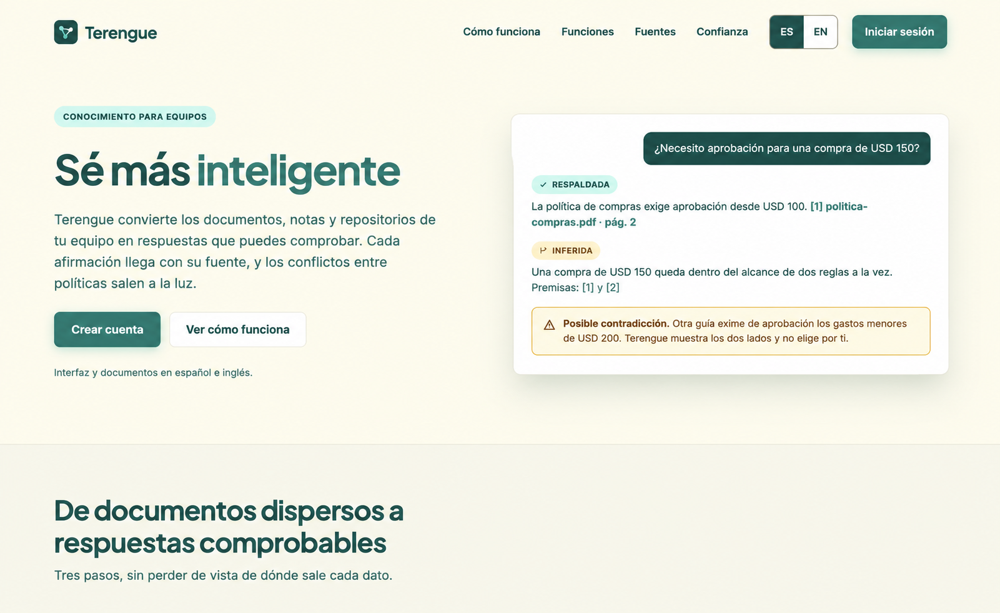

# Terengue · Second Brain

**Equipo Out of the Box** · 🏆 **Ganadores de la Hackathon de BoxLang, junto con ANIA** — [ver el proyecto en DevPost](https://devpost.com/software/terengue)



> Terengue convierte los documentos, notas y repositorios de tu equipo en respuestas que puedes comprobar. Cada afirmación llega con su fuente y las contradicciones entre políticas salen a la luz. Interfaz y documentos en español e inglés.

---

## 🎯 ¿Qué es este proyecto?

`second-brain` es el módulo **Pure BoxLang reutilizable** detrás de Terengue: cuentas, espacios, sesiones, permisos, biblioteca privada e indexación con recuperación con evidencia. El frontend en Next.js delega las rutas same-origin a BoxLang; la autorización, la persistencia y las reglas de negocio viven en `backend/secondBrain/AccountService.bx`.

**Estado:** fases 00, 01, 02 y 03 **verificadas en su alcance** (TXT/notas, PDF con texto extraíble, chat y evidencia). Pendientes: otros formatos, grafo, contradicciones y despliegue remoto. [Registro de implementación](docs/plan/evidence/phase03-implementation.md).

## 🧱 Stack

- **BoxLang** MiniServer/CLI 1.18.0+66 · **BoxLang AI** 3.5.0 · **bx-postgresql** 1.2.0
- **PostgreSQL** 17.11 + **pgvector** 0.8.7
- **Next.js** 16.4.0 · React 19.3.0 · TypeScript · Tailwind CSS · Node.js 24.21.0
- **Docker Compose**: no hace falta instalar runtimes ni módulos en el equipo

## 🚀 Levantar el entorno

Requisito: Docker y Docker Compose.

```bash
cp .env.example .env                 # cambia POSTGRES_PASSWORD
FRONTEND_PORT=3002 BACKEND_PORT=8082 POSTGRES_PORT=55435 \
  docker compose -p second-brain-phase01 up -d --build --wait
docker compose -p second-brain-phase01 exec boxlang boxlang backend/migrations/migrate.bxs
docker compose -p second-brain-phase01 exec boxlang boxlang tests/smoke.bxs
```

| Servicio | Dirección local |
|---|---|
| Frontend | http://127.0.0.1:3002 |
| BoxLang | http://127.0.0.1:8082 · health: `GET /api/health.bxm` |
| PostgreSQL | `127.0.0.1:55435` |

La migración es versionada e idempotente: ejecútala también al actualizar un volumen existente. Los puertos se ajustan con `FRONTEND_PORT`, `BACKEND_PORT` y `POSTGRES_PORT`.

### Indexación y chat con IA (opcional, facturable)

El arranque básico no activa IA ni procesa documentos. Para habilitarlo, configura en tu `.env` privado `OPENAI_API_KEY`, `P00_ALLOW_PROVIDER_CALLS=YES`, `COMPOSE_PROFILES=ai` y `BUDGET_DAILY_USD=1`, y recrea los servicios con `docker compose up -d --build --wait`. Admite TXT, notas y PDF con texto extraíble; el worker procesa pendientes cada 5 segundos. [Detalles, tarifas y coste](docs/plan/evidence/phase00-closure.md).

## ✅ Comprobaciones

```bash
docker compose -p second-brain-phase01 exec boxlang boxlang tests/phase01-crypto.bxs
docker compose -p second-brain-phase01 exec boxlang boxlang tests/phase01-expiry.bxs
docker compose exec -T boxlang boxlang tests/vector-roundtrip.bxs
docker compose exec -T boxlang boxlang tests/probe.bxs
```

La suite HTTP completa y las pruebas de UI están en [docs/plan/evidence](docs/plan/evidence); usa un `P01_RUN`/`P02_RUN` nuevo en cada ejecución.

## 🔌 API

Next.js expone solo estas rutas same-origin y las delega a `backend/api/account.bxm`:

| Ruta | Método | Resultado correcto |
|---|---|---|
| `/api/auth/register` | POST | `202`, respuesta genérica también para correo duplicado |
| `/api/auth/login` | POST | `200`, usuario + token CSRF; sesión solo en cookie HttpOnly |
| `/api/auth/current` | GET | `200`, usuario + CSRF de la sesión vigente |
| `/api/auth/logout` | POST | `200`, invalida la sesión y expira la cookie |
| `/api/spaces` | GET / POST | `200` lista / `201` crea espacio con rol admin atómico |
| `/api/spaces/:spaceId` | GET | `200` solo con membresía efectiva |
| `/api/spaces/:spaceId/members` | GET / POST | `200`, gestión solo admin |
| `/api/spaces/:spaceId/members/:memberId` | PATCH / DELETE | `200`, `409` si se quita o degrada al último admin |

Roles: `admin`, `editor`, `reader`. Sesiones de 12 h con solo SHA-256 del token en PostgreSQL, cookie `HttpOnly; SameSite=Lax` (`Secure` con HTTPS), PBKDF2-HMAC-SHA256 (600.000 iteraciones) y límite de 10 intentos por correo y ventana de 15 minutos.

## 🌐 Despliegue en Coolify

- `compose.yaml` no publica puertos del host; el override local los mapea a loopback. Si Coolify invoca Compose con `-f compose.yaml`, publica el frontend en su puerto interno `3000` y configura el dominio **solo** en `frontend`.
- Configura `APP_ORIGIN` con el origen HTTPS **exacto** que ve el navegador (sin ruta, barra final ni `:3000`). Si el login devuelve `403`, revisa esa variable y redespliega BoxLang; no desactives la validación de Origin/CSRF.
- No asignes dominios a `boxlang` ni `postgres`: se comunican por sus nombres internos (`boxlang:8080`, `postgres:5432`).
- Reconstruye las imágenes al desplegar cambios y no elimines los volúmenes. Tras desplegar: `docker compose exec boxlang boxlang backend/migrations/migrate.bxs` y `docker compose exec boxlang boxlang tests/smoke.bxs`.
- El despliegue remoto **aún no se ha probado**; no actives HMR en el proxy público.

## ⚠️ Notas importantes

- Las claves de IA van **solo** en `.env` privado: nunca en el repositorio, este chat ni los logs.
- `APP_ORIGIN` debe coincidir con el origen del navegador; HTTP solo para `localhost`/`127.0.0.1`. No publiques estos servicios directamente a Internet.
- No se han guardado secretos, documentos privados ni claves de IA en el repositorio.

## 📚 Referencias

- [Proyecto en DevPost](https://devpost.com/software/terengue)
- [MCP de BoxLang](https://boxlang.ortusbooks.com/~gitbook/mcp) · [Módulos Pure BoxLang](https://boxlang.ortusbooks.com/boxlang-framework/module-development/getting-started#pure-boxlang) · [BoxLang AI](https://ai.ortusbooks.com) · [pgvector](https://github.com/pgvector/pgvector)
- Evidencia: [fase 00](docs/plan/evidence/phase00-closure.md) · [fase 01](docs/plan/evidence/phase01-review.md) · [fase 02](docs/plan/evidence/phase02-closure.md) · [fase 03](docs/plan/evidence/phase03-implementation.md)
